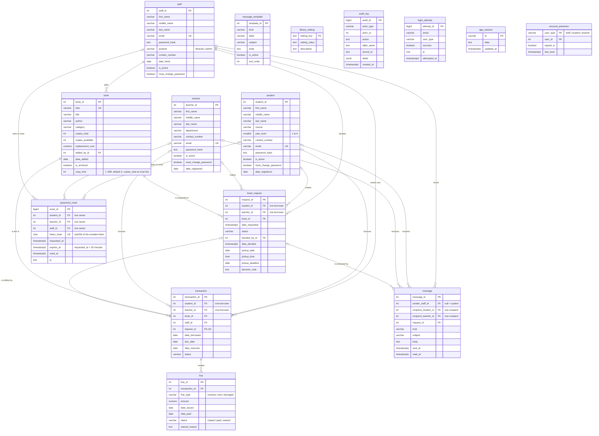

# Entity relationship diagram

The 15 tables of the LibraryInventorySystem (schema `lms`). docs/SPEC.md is the source of truth; this diagram follows it.

`message_template`, `library_setting`, `audit_log`, `login_attempt` and `app_session` (sessions when SESSION_DRIVER=db) and `account_presence` (who is signed in now) stand alone. Routines read the templates and settings by key, the audit trigger writes `audit_log`, and the sign-in routines in `04b_auth.sql` write `login_attempt`. `password_reset` belongs to exactly one student, teacher or staff member and is deleted with them; it has no audit trigger, because the trigger would copy the token hash.

## How the request, loan and fine flow connects the tables

A student or teacher creates a `book_request` for a `book`. A staff member approves it, which reserves one copy (`copies_available` goes down by one) and sends a `message` with the pickup date and time, or rejects it with a reason and a message. When the borrower comes to the desk, the approved request is issued as a `transaction` (the loan) that points back to the request, and the request becomes fulfilled. Walk-in loans are a `transaction` with no request. When the book comes back, the loan is closed as returned or lost, and any late days, damage or loss create rows in `fine` linked to that loan. Every table in this chain points to exactly one borrower: a student or a teacher, never both. History rows use ON DELETE RESTRICT, so a person or book with history is deactivated or archived instead of deleted.
